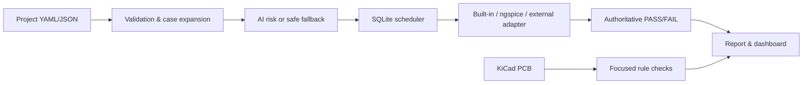

# SimOps Studio

SimOps Studio 是一套可在本機執行的 EDA 模擬自動化工作台。它把工程參數驗證、
參數展開、任務派工、失敗重試、斷點續跑、AI 風險排序、PCB 基礎規則檢查與
可追溯報告串成一條完整流程。

本專案只使用原創的合成電路與 PCB 範例，不需要帳號、API key、商用 EDA 軟體
或外部資料集即可完成示範。內建求解器著重展示公司實務中的自動化架構；正式
SI/PI 簽核仍應使用經校準的量測流程與生產級工具。

## 使用情境

模擬團隊收到一批 PDN 去耦參數組合，需要一致地執行頻率掃描、優先處理高風險
案例、保存每次派工與結果，並輸出可交付的報告。人工逐案設定容易造成漏跑、
重跑與版本不可追溯；SimOps Studio 將這些步驟標準化並保留稽核紀錄。

| 階段 | 定義 |
|---|---|
| 輸入 | YAML/JSON 專案設定、PDN 元件參數、掃頻範圍、阻抗門檻、工作節點、可選 KiCad PCB |
| 處理 | 嚴格驗證 → 參數掃描展開 → 風險排序 → SQLite 派工／重試／續跑 → 模擬 → PCB 規則檢查 → 彙整 |
| 輸出 | SQLite 狀態庫、CSV、JSON、阻抗圖、批次統計圖、自包含 HTML 報告、唯讀本機儀表板與模型中繼資料 |



## 已完成的核心功能

- 嚴格的 YAML/JSON 設定契約、路徑解析與確定性雜湊。
- RLC 集總模型的 PDN 頻率掃描與目標阻抗 PASS/FAIL。
- KiCad `.kicad_pcb` 網路、銅層、走線、via、封裝與基礎製造規則解析。
- `builtin-pdn`、可選 `ngspice`、安全的無 shell 外部命令介接器。
- SQLite 任務、結果、事件與執行狀態；支援 worker capability、重試與續跑。
- Random Forest 風險排序；超出訓練範圍時回傳中性 `0.5`，且不取代模擬結果。
- CSV/JSON/PNG/自包含 HTML 報告與僅綁定 loopback 的唯讀儀表板。
- 15 項 unit、integration、end-to-end 自動測試與 Windows CI。

## 快速開始

需求：Windows PowerShell、Python 3.11+、Git。內建示範不需要 KiCad 或 ngspice。

```powershell
git clone <your-repository-url>
cd simops-studio
python -m venv .venv
.\.venv\Scripts\Activate.ps1
python -m pip install --upgrade pip
python -m pip install -r requirements-lock.txt
python -m pip install -e . --no-deps
.\scripts\run-demo.ps1
```

示範完成後開啟 `outputs/demo/report.html`，或啟動每 5 秒更新的本機儀表板：

```powershell
python -m simops_studio dashboard examples/project.yaml
```

瀏覽 `http://127.0.0.1:8080`，按 `Ctrl+C` 停止服務。儀表板拒絕綁定非本機位址。

## 常用命令

```powershell
python -m simops_studio doctor
python -m simops_studio validate examples/project.yaml
python -m simops_studio pcb-check examples/project.yaml
python -m simops_studio simulate examples/project.yaml --case-index 0
python -m simops_studio run examples/project.yaml --train-ai
python -m simops_studio status examples/project.yaml
python -m simops_studio predict examples/project.yaml
python -m simops_studio report examples/project.yaml
.\scripts\verify.ps1
```

`run` 預設略過已完成且輸入雜湊相同的案例；加上 `--force` 才會重新執行。

## 可重現示範結果

隨附設定展開 24 個合成案例。在目前基準版中，內建求解器產生 12 個 PASS、
12 個 FAIL；第二次執行會從 SQLite 略過全部 24 個完成案例。Random Forest 使用
24 筆結果訓練，在 6 筆固定分層留出資料上得到 `1.0` balanced accuracy。
這只是拓樸簡單、樣本很小的流程驗證，不是模型泛化能力或生產準確度證明。

所有執行產物與模型都留在 Git 忽略的 `outputs/`、`models/local/`，報告中的設定、
PCB、模型與產物附有 SHA-256，可追查同一次執行的來源。

## 專案結構

```text
src/simops_studio/   應用程式、模擬、EDA adapters、AI、資料庫與報告
examples/            可直接執行的合成設定與 KiCad PCB
tests/               unit、integration 與 end-to-end 測試
scripts/             PowerShell 示範與驗證入口
docs/                架構、EDA 介接、示範、模型卡與限制
models/local/        本機訓練模型（Git 忽略）
outputs/             資料庫與報告（Git 忽略）
```

進一步閱讀：[架構](docs/ARCHITECTURE.md)、[EDA 介接](docs/EDA_INTEGRATION.md)、
[開發流程與 SQL](docs/DEVELOPMENT.md)、[示範操作](docs/DEMO.md)、
[模型卡](docs/MODEL_CARD.md)、[限制與後續](docs/LIMITATIONS.md)。

## 安全與公開邊界

- 設定檔不需要秘密資訊；`.env`、資料庫、模型與 EDA 產物預設不進 Git。
- 驗證腳本會檢查追蹤檔中的密鑰特徵、使用者家目錄、敏感副檔名與大型檔案。
- 外部命令使用 token list、`shell=False`、暫存工作目錄與固定逾時。
- 儀表板只允許 `127.0.0.1`、`localhost` 或 `::1`，不是具認證的正式服務。
- 範例 PCB 檢查不等同原生 clearance/connectivity DRC；集總模型不等同場求解器。

完整技術邊界請見 [docs/LIMITATIONS.md](docs/LIMITATIONS.md)。授權採 MIT；第三方套件
保留其原授權，詳見 [THIRD_PARTY_NOTICES.md](THIRD_PARTY_NOTICES.md)。
